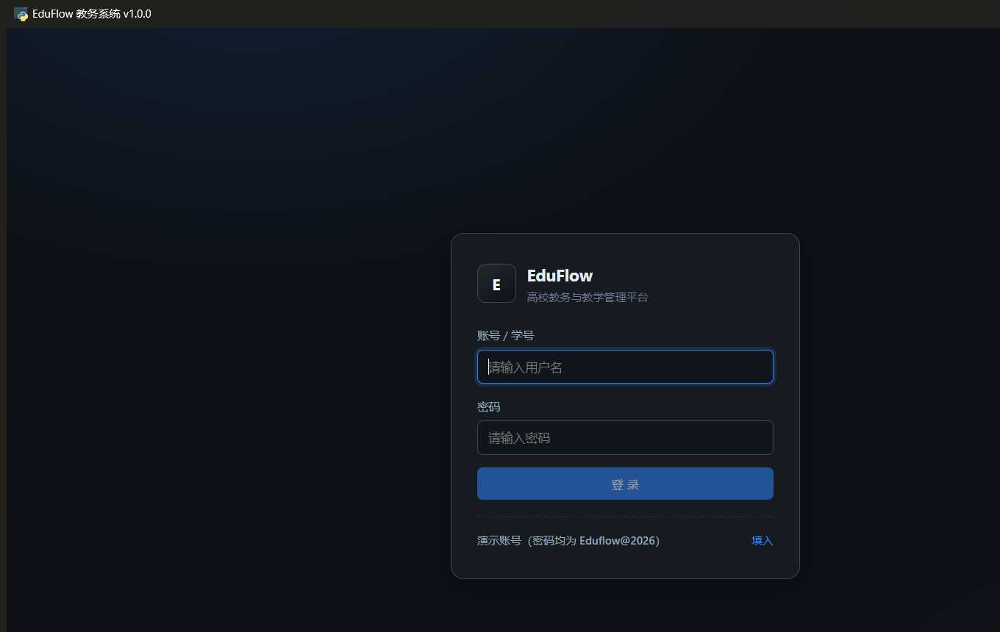
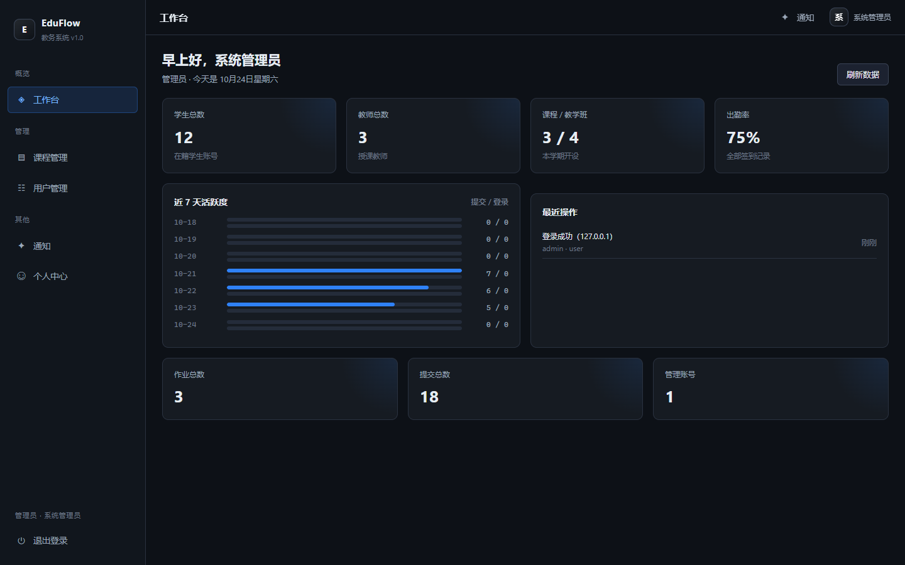
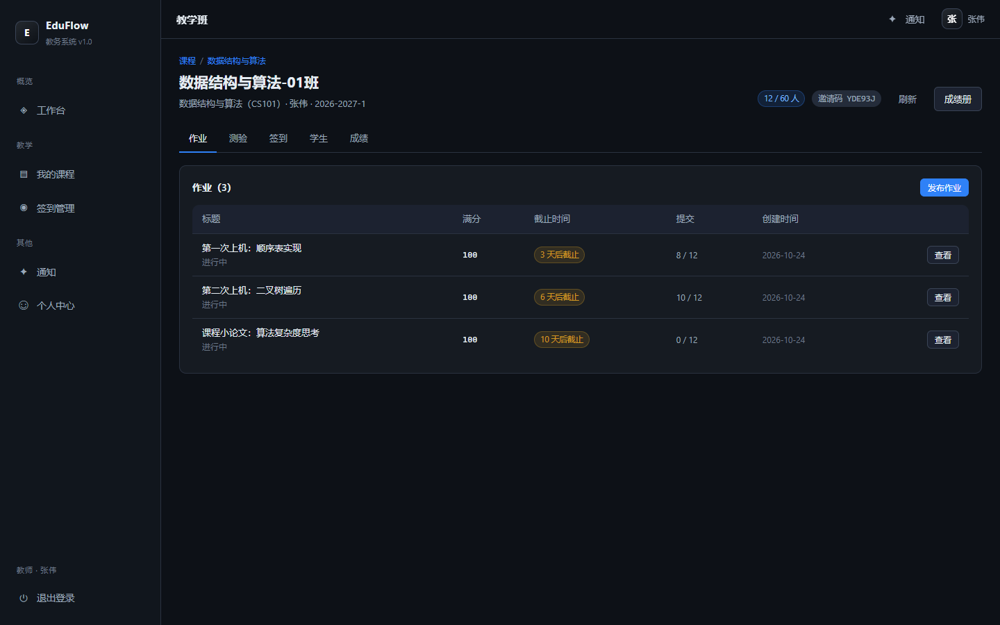
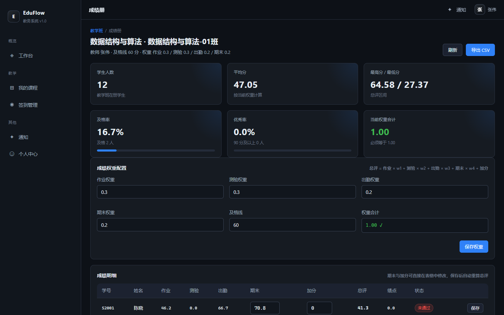
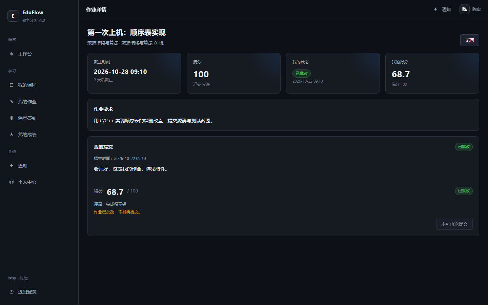

# EduFlow 教务系统

面向高校场景的**桌面端教务与教学管理平台**，功能对标"学习通"：课程与教学班、作业发布与批改、
在线测验与自动判分、课堂签到（码/位置/迟到判定）、资料共享、讨论区、成绩加权与绩点、教学统计。

技术形态：**Python 后端 + Vue3 前端 + WebView2 桌面壳**，全部数据存本地 SQLite，离线可用、无需联网。

```
┌──────────────────────────────────────────────────┐
│  pywebview 窗口（WebView2 内核）                 │
│  ┌────────────────────────────────────────────┐  │
│  │  Vue3 SPA（Vite 构建，hash 路由）          │  │
│  └───────────────┬────────────────────────────┘  │
│                  │ HTTP / JSON（本地回环）       │
│  ┌───────────────▼────────────────────────────┐  │
│  │  Python 内置 HTTP 服务器（标准库）         │  │
│  │  Router → API → Service → Repository       │  │
│  └───────────────┬────────────────────────────┘  │
│                  │                              │
│            SQLite（WAL 模式）                    │
└──────────────────────────────────────────────────┘
```

---

## 一、快速开始

### 1. 环境要求

| 依赖 | 版本 | 说明 |
|---|---|---|
| Python | 3.11+（开发环境 3.14.2） | 运行时 |
| Node.js | 18+（开发环境 24.22 LTS） | 仅构建前端时需要 |
| WebView2 Runtime | 任意 | Windows 10/11 一般已自带 |

### 2. 安装

```powershell
# 后端依赖（只有 pywebview 一个）
python -m venv .venv
.\.venv\Scripts\python.exe -m pip install -r requirements.txt

# 前端构建
cd frontend
npm install
npm run build
cd ..
```

### 3. 启动

```powershell
.\.venv\Scripts\python.exe run.py
```

首次启动会自动建库并写入演示数据，随后弹出桌面窗口。

**用 PyCharm 运行**：用 PyCharm 打开项目目录后，右上角运行配置下拉框里已预置两个配置
（源自 `.idea/runConfigurations/`）：

| 配置 | 作用 |
|---|---|
| `EduFlow Desktop` | 启动桌面窗口（pywebview + WebView2），对应 `run.py` |
| `EduFlow Web` | 只启动 HTTP 服务，对应 `backend/cli.py serve --port 8765`，用浏览器访问 |

选中后按 `Shift+F10`（或点绿色 ▶）即可，解释器指向项目内的 `.venv`。
两个配置可以同时跑：`run.py` 检测到端口被占用会自动顺延到 8766。

其它启动方式：

```powershell
# 用系统浏览器打开（不开桌面窗口）
python run.py --browser

# 只用命令行起服务，方便前后端分离调试
python -m backend.cli serve

# 前端热更新开发（另开一个终端）
cd frontend && npm run dev
```

### 4. 演示账号

密码统一为 **`Eduflow@2026`**

| 角色 | 账号 | 说明 |
|---|---|---|
| 管理员 | `admin` | 全局看板、用户管理、审计日志 |
| 教师 | `t1001` / `t1002` / `t1003` | 建课、发作业、批改、测验、签到 |
| 学生 | `s2001` ~ `s2012` | 选课、交作业、答题、签到、查成绩 |

---

## 二、界面预览

桌面窗口（WebView2 内核，真实运行截图）：



| 管理员工作台 | 教学班详情 |
|---|---|
|  |  |

| 成绩册（权重可配） | 学生作业详情 |
|---|---|
|  |  |

更多截图见 `docs/screenshots/`（登录、课程、签到、成绩单、通知、用户管理等 15 张）。

---

## 三、在 GitHub Codespaces 中运行（无需本机环境）

仓库已内置 `.devcontainer`：创建 Codespace 后会自动装 Python/Node 依赖、构建前端、初始化数据库。

1. 打开仓库 → **Code** → **Codespaces** → **Create codespace on main**
2. 等待容器初始化（约 2–3 分钟，日志里会看到「环境就绪」）
3. 在终端执行：

```bash
bash scripts/codespace_start.sh
```

4. 端口 `8765` 会自动转发并弹出浏览器；若没有，去 **PORTS** 面板点击 8765 的 🌐 图标。
   该端口在 `devcontainer.json` 里配置为 **public**，可直接用链接访问。

> 说明：Codespaces 没有图形界面，所以 `run.py`（pywebview 桌面窗口）只能在 Windows 本机用；
> 云端用 `backend.cli serve` 起同一个后端 + 同一份前端产物，功能完全一致。
>
> 安全提示：端口设为 public 意味着任何拿到链接的人都能访问，演示完记得停止 Codespace，
> 并修改默认管理员密码。

---

## 四、功能清单

### 课程与教学班
- 课程创建/归档，一门课可开多个教学班，每个班有独立邀请码
- 学生凭邀请码加入，教师可手动添加/移出，容量限制
- 课程资料上传（multipart）、下载、分类、下载量统计

### 作业
- 发布作业：正文、附件、满分、截止时间、是否允许迟交、迟交扣分比例
- 学生提交（覆盖式，已批改后锁定），迟交自动标记并按天扣分
- 教师查看全部提交、缺失名单、逐份打分与评语、批量批改
- 发布/批改自动给相关学生推送站内通知

### 在线测验
- 题库题型：单选、多选、判断、填空、简答
- 组卷、限时、题目乱序（按 学生+测验 稳定打乱）
- 自动判分：单选/多选/判断精确匹配，填空支持 `|` 分隔多答案，简答留人工
- 断点续答：每 10 秒自动保存，超时自动交卷
- 成绩排行、及格率、最高/最低分统计

### 课堂签到
- 三种方式：数字码、二维码（前端渲染同一码）、位置签到（Haversine 距离校验）
- 迟到判定：开始后 10 分钟内为正常，之后记迟到
- 教师补签/改签、结束签到、班级出勤汇总（正常/迟到/缺席/请假）

### 成绩
- 每个教学班独立配置权重（作业/测验/出勤/期末），校验权重和为 1
- 分项归一化为百分制后加权，支持加分项、期末录入
- 自动换算 4.0 绩点，生成班级成绩册、排名、及格率/优秀率
- 一键导出 CSV（Excel 可直接打开，带 BOM 不乱码）

### 讨论与通知
- 课程讨论区：发帖、回复、置顶、锁定
- 站内通知：未读数、已读、全部已读、清空已读，管理员可广播

### 统计与审计
- 管理员看板：用户/课程/教学班统计、7 日活跃趋势、最近操作
- 教师看板：教学班、学生数、待批改数、即将截止作业
- 学生看板：待交作业、出勤率、作业均分
- 审计日志：登录、建课、发布、批改、改密等关键动作全记录

---

## 五、代码结构

```
eduflow/
├── backend/
│   ├── app.py                 应用装配：路由 + 认证 + 静态资源 + 错误处理
│   ├── config.py              路径、端口、安全参数、业务阈值
│   ├── cli.py                 命令行：init / seed / reset / serve / check / info
│   ├── core/                  基础能力
│   │   ├── clock.py           时间（统一 UTC ISO 存储）
│   │   ├── errors.py          业务异常体系
│   │   ├── ids.py             令牌与短码生成
│   │   ├── permissions.py     角色与课程权限判定
│   │   ├── security.py        PBKDF2 口令、HMAC 签名
│   │   └── validators.py      入参校验与类型转换
│   ├── db/
│   │   ├── schema.sql         22 张表的完整结构
│   │   ├── connection.py      线程内连接、WAL、事务
│   │   ├── migrations.py      版本迁移框架
│   │   └── seed.py            演示数据
│   ├── http/                  自研最小 HTTP 层（无三方框架）
│   │   ├── router.py          路径参数路由表
│   │   ├── server.py          ThreadingHTTPServer 封装
│   │   ├── request.py / response.py
│   │   ├── multipart.py       multipart/form-data 解析
│   │   └── static.py          SPA 静态资源与目录穿越防护
│   ├── repositories/          数据访问（10 个仓储）
│   ├── services/              业务逻辑（11 个服务）
│   └── api/                   91 个 REST 接口
├── frontend/
│   ├── src/
│   │   ├── api/client.js      请求封装与格式化工具
│   │   ├── stores/            Pinia：auth / ui
│   │   ├── router/            hash 路由 + 登录与角色守卫
│   │   ├── styles/main.css    设计系统（深色主题）
│   │   └── views/             13 个页面
│   └── vite.config.js
├── tests/smoke_test.py        34 项端到端冒烟测试
├── run.py                     桌面入口（pywebview）
└── requirements.txt
```

分层原则：**API 只做参数搬运，Service 承载业务规则，Repository 只管 SQL**。
HTTP 层是自研的，不依赖 Flask/FastAPI，整个后端除 pywebview 外零第三方依赖。

---

## 六、开发命令

```powershell
# 建库
python -m backend.cli init

# 重新灌演示数据（会清空）
python -m backend.cli reset

# 环境自检
python -m backend.cli check

# 数据概览
python -m backend.cli info

# 端到端测试（使用临时数据库，不影响开发数据）
python tests/smoke_test.py
```

前端：

```powershell
cd frontend
npm run dev      # 热更新，代理 /api 到 127.0.0.1:8765
npm run build    # 产物输出 dist/，由后端静态托管
```

---

## 七、接口约定

统一响应信封：

```json
{ "ok": true,  "data": { ... }, "message": "可选提示" }
{ "ok": false, "error": { "code": "validation_error", "message": "参数不合法" } }
```

鉴权：`Authorization: Bearer <token>`，令牌有效期 72 小时，存于 `sessions` 表，可主动吊销。
同一账号连续登录失败 8 次将锁定 5 分钟。

常用接口（完整清单可登录后访问 `GET /api/routes`）：

| 方法 | 路径 | 说明 |
|---|---|---|
| POST | `/api/auth/login` | 登录 |
| GET | `/api/dashboard` | 按角色返回看板 |
| GET | `/api/courses` | 课程列表 |
| POST | `/api/assignments` | 发布作业 |
| POST | `/api/assignments/{id}/submit` | 提交作业 |
| POST | `/api/submissions/{id}/grade` | 批改 |
| POST | `/api/quizzes/{id}/start` | 开始答题 |
| POST | `/api/quizzes/{id}/submit` | 交卷判分 |
| POST | `/api/attendance/{id}/check-in` | 学生签到 |
| GET | `/api/classes/{id}/gradebook` | 成绩册 |
| GET | `/api/classes/{id}/grades/export` | 导出 CSV |

---

## 八、实现说明

- **为什么自研 HTTP 层**：桌面应用只需要本机回环通信，标准库足够；少一层依赖就少一处
  打包/兼容风险（尤其在 Python 3.14 上）。
- **为什么时间统一存 UTC**：前端只做展示层转换，跨时区与夏令时不会算错；签到、截止判断
  全部在服务端完成，避免客户端改时间作弊。
- **安全**：口令 PBKDF2-HMAC-SHA256（18 万次迭代 + 随机盐）；令牌 64 位十六进制；
  所有写操作都有权限校验与审计日志；静态资源做了目录穿越防护。
- **离线**：无任何外部 CDN / 云服务依赖，断网可用。

---

## 九、许可证

仅用于学习与演示。演示数据中的姓名、学号、课程均为虚构。
